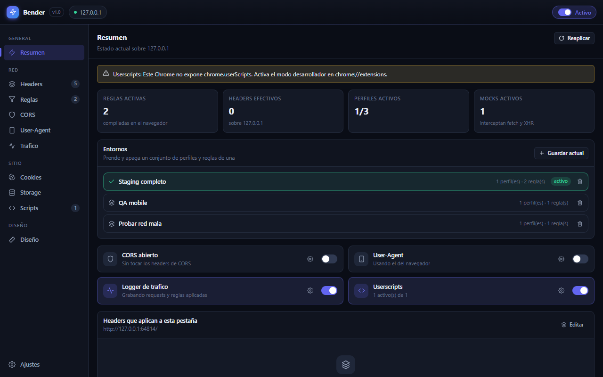

# Bender

**Doblale las requests al navegador.**

Extensión de Chrome (Manifest V3) que junta en una sola herramienta lo que hacen ModHeader,
Cookie-Editor, Tampermonkey y "Allow CORS", pensada para el día a día de desarrollo.



## Qué hace

- **Headers**: perfiles de request y response con `set`, `append` y `remove`, varios activos a
  la vez, alcance por dominio, URL, tipo de recurso o sólo la pestaña activa, y valores
  dinámicos (`{{uuid}}`, `{{timestamp}}`, `{{tabUrl}}`…).
- **Reglas de tráfico**: bloquear, redirigir con regex o mockear una URL con status, headers,
  body y delay.
- **CORS**: un switch que reescribe `Access-Control-Allow-*`, refleja el origen real cuando hay
  credenciales y puede sacar CSP o `X-Frame-Options`.
- **User-Agent**: presets de mobile, desktop y bots, client hints y spoof de `navigator`.
- **Cookies y storage**: ABM completo, apagado individual, decodificador de JWT y snapshots por
  dominio para saltar entre usuarios logueados de un click.
- **Scripts**: JavaScript y CSS propios por sitio, con match patterns y elección de mundo.
- **Tráfico**: log en vivo con los headers que salieron de verdad y qué regla tocó cada
  request; copia como cURL o `fetch`, export a HAR y "convertir en mock".
- **Diseño**: box model, regla, medidor de espaciados, cuentagotas y auditoría de paleta,
  tipografías y variables `:root`.

La UI es la misma en el popup, el panel lateral y una pestaña completa: sólo cambia el ancho.

## Instalar

Necesita Chrome 120 o más nuevo con el modo desarrollador prendido (por `chrome.userScripts`).

```bash
pnpm install
pnpm build
```

En `chrome://extensions`: **Modo de desarrollador** → **Cargar descomprimida** → la carpeta
`dist/`.

## Desarrollo

`pnpm dev` deja todo en watch. Los cambios de UI piden cerrar y abrir el popup; los del
service worker, un click en ↻ en `chrome://extensions`. El gate es `pnpm verify`; los e2e de
Playwright van aparte porque necesitan un Chrome.

## Documentación

- [docs/decisiones.md](docs/decisiones.md): cómo se compilan las reglas, quién gana entre
  ellas y por qué los mocks no pasan por DNR.
- [docs/limitaciones.md](docs/limitaciones.md): lo que la plataforma no deja hacer.
- [docs/importar.md](docs/importar.md): importar desde ModHeader y Cookie-Editor.
- [store/](store/): la ficha y la política de privacidad de la Chrome Web Store.
